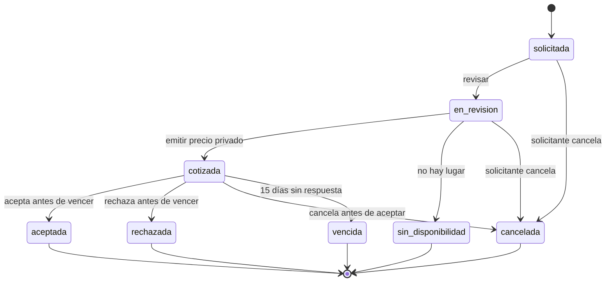

# Estados de solicitudes de espacio

El precio no aparece en el catálogo público. La persona conserva folio y clave; la clave solo se entrega al crear la solicitud y se guarda como hash. El personal local accede únicamente a solicitudes de sus iglesias.

P-10 debe confirmar si los 15 días son exactos desde la emisión o hasta el cierre del día local. La implementación inicial usa 15 periodos de 24 horas exactas.
