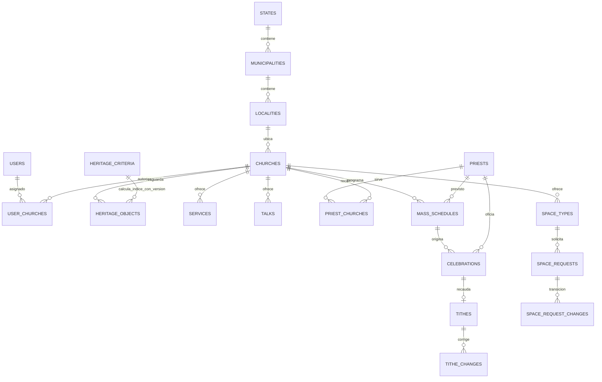

# Modelo de datos de Ecclesia

## Identidad geográfica y aislamiento

Las claves de entidad (`char(2)`), municipio (`char(5)`) y localidad (`char(9)`) se conservan como texto de INEGI para mantener ceros iniciales. Cada iglesia pertenece a una localidad y tiene una zona horaria IANA. `user_churches` determina el alcance local; nunca se autoriza una operación solo porque el usuario conozca el ID de la iglesia.

El vínculo entre `HERITAGE_CRITERIA` y `HERITAGE_OBJECTS` del diagrama representa la versión aplicada en el cálculo, no una columna directa en cada objeto. La versión vigente y el año de referencia deben acompañar la respuesta del ranking para hacerlo reproducible.

## Decisiones de integridad

- Iglesia cerrada: `status='cerrada'` y fecha; no se borra.
- Objeto: exactamente uno entre año y siglo; estado conservado.
- Servicio: solo precio fijo tiene importe; gratuito o donativo no publican un importe obligatorio.
- Horario: día de semana, hora local, zona de la iglesia y duración; celebración: fecha local e instante UTC, oficiante real y motivo si sustituyó.
- Diezmo: `UNIQUE(celebration_id)` y `BIGINT` de centavos; cambios con importe anterior, nuevo, autor y fecha.
- Solicitud: folio y hash de clave; datos de contacto privados; cotización con vencimiento y registro de cada transición.

## Datos externos

`data/inegi-geo.json` conserva fuente y fecha de descarga del [Catálogo Único del INEGI](https://www.inegi.org.mx/servicios/catalogounico/). Se importan los 32 estados y todos los municipios; solo las localidades usadas en los seeds ficticios. P-01 sigue pendiente para el corte exigido por el docente.
